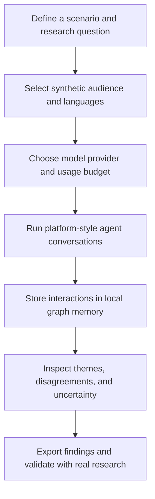

# MiroInd 🇮🇳

### Simulate India's conversations. Before you launch.

**An open-source, India-focused multi-agent simulation project for exploring how different communities might respond to a product, policy, or campaign.**

Hindi-first experiences. Regional perspectives. Local-first memory. Built with Indian founders, researchers, and developers in mind.

[Vision](#why-miroind) · [Use cases](#what-could-you-explore) · [Roadmap](#roadmap) · [Contribute](#contribute)

> **Status: planning / documentation-only.** This repository currently contains the project vision and roadmap. The simulation engine, integrations, UI, and demos described below are proposed—not implemented. There is no runnable application yet.

---

## Why MiroInd?

India is not one audience.

A pricing change can land differently with a student in Pune, a shop owner in Jaipur, a commuter in Chennai, and a creator in Lucknow. Language, local context, affordability, and the platform where a conversation starts all matter.

MiroInd aims to make those differences easier to explore through transparent, configurable agent-based simulations—without making cloud-only infrastructure the default.

**The idea:** provide a scenario, configure a synthetic audience, simulate conversations, and inspect the assumptions and possible outcomes.

**The goal is exploration, not prediction.** Simulated agents are not real people, a representative survey, or evidence of what India actually thinks.

## What we're building

| Focus | Planned direction |
| --- | --- |
| **India-native personas** | Editable synthetic persona packs organized by state, language, age, occupation, income band, and city tier. |
| **Hindi-first experience** | Hindi and English interfaces, prompts, and reports, followed by Tamil, Telugu, Marathi, and Bengali. |
| **Natural code-mixing** | Support for Hindi–English conversations and, later, additional regional language combinations. |
| **Platform-aware conversations** | Simulated Instagram-style posts and Reels discussions, WhatsApp-style groups and forwarding, ShareChat/Moj-style interactions, plus X and Reddit. |
| **Local-first graph memory** | Evaluate Neo4j with Graphiti or Kuzu as local memory options, rather than requiring a hosted memory service. |
| **Flexible model providers** | Plan for OpenAI-compatible endpoints such as Groq, Together, and Fireworks, alongside local Ollama models. Regional-language quality will need evaluation. |
| **Inspectable results** | Reports that expose persona assumptions, model choices, simulation settings, and uncertainty—not just a single sentiment score. |
| **Affordable experimentation** | A lightweight quick-simulation mode, configurable agent counts, and explicit usage budgets. |

These are design targets, not current capabilities. Platform names describe intended simulation formats; no official platform integration or affiliation is implied.

## What could you explore?

### Product and pricing

How might a subscription price change affect students, gig workers, and small businesses across city tiers? What objections should a team investigate with real users?

### Public policy research

What questions, misunderstandings, or accessibility concerns might arise around a proposed scheme? Compare clearly documented scenarios without treating the output as polling or an election forecast.

### Brand and crisis communication

How could the same announcement be interpreted in a short-form video discussion versus a private group conversation? Which wording deserves further human review?

### Creator and content research

How might language and local context change the interpretation of a creator's message? Explore alternative explanations before testing content with real audiences.

### Early-stage market research

Use synthetic conversations to generate interview questions and product hypotheses—not to replace focus groups, representative research, or community consultation.

## Planned starter scenarios

| Scenario | Example research question |
| --- | --- |
| **Hypothetical UPI merchant fee** | What concerns might small merchants and customers raise about a proposed fee? |
| **Free bus travel scheme for women** | How might commuters discuss affordability, access, safety, and implementation? |
| **Ride-hailing price competition** | How might riders and drivers weigh lower fares against reliability and earnings? |
| **Regional-language app launch** | What onboarding and trust questions could arise for first-time users? |
| **GST-related pricing update** | How might customers interpret a price change, and what explanation would be clearer? |
| **Cricket sponsorship controversy** | How might different fan communities interpret a fictional brand response? |

All starter scenarios should use fictional or clearly labeled hypothetical inputs. They must not imply that a proposed charge, rule, or controversy is a real event.

## Proposed workflow

### Design principles

- **Local-first, not local-only.** Aim to keep scenario data and memory on your machine by default, with optional hosted providers.
- **Transparent assumptions.** Persona templates and model configuration should be inspectable and editable.
- **Language quality over checkbox support.** Evaluate regional-language outputs with native speakers.
- **Reproducible where possible.** Record configuration, prompts, and seeds while acknowledging model nondeterminism.
- **Cost visibility.** Make agent counts, model usage, and budget limits explicit.

Using a hosted model sends submitted prompts and context to that provider and may incur charges. Local graph storage alone does not make a workflow fully offline or private; fully local operation would also require a local model and local supporting services.

## Roadmap

### Phase 1 — Establish the foundation

- [ ] Evaluate the MiroFish architecture and upstream license before reusing code.
- [ ] Document the implementation stack and a minimal runnable simulation.
- [ ] Add Hindi and English prompts and report templates.
- [ ] Create 8–10 editable Indian synthetic persona templates.
- [ ] Prototype Instagram-style, WhatsApp-style, and X-style interactions.
- [ ] Select and implement a local graph-memory backend.
- [ ] Add 3–4 documented Indian demo scenarios.

### Phase 2 — Build India-specific depth

- [ ] Support Hindi–English code-mixed agent conversations.
- [ ] Add state-level and regional audience comparisons.
- [ ] Model group participation, forwarding, and status-style sharing.
- [ ] Build a web UI with Hindi/English switching.
- [ ] Evaluate Tamil, Telugu, Marathi, and Bengali support.
- [ ] Publish evaluation methods and known simulation limitations.

### Phase 3 — Make it easy to run and inspect

- [ ] Provide Docker-based setup with a local-model option.
- [ ] Add a smaller, budget-friendly quick-simulation mode.
- [ ] Export Hindi and English reports, including PDF.
- [ ] Add configuration capture and experiment comparisons.
- [ ] Publish contributor documentation and reproducible examples.

Milestones are directional; no release dates or performance claims are promised yet.

## Responsible use

MiroInd is intended for research, learning, and testing hypotheses—not manufacturing public opinion.

- **Do not treat synthetic output as public sentiment, polling, or a forecast.** Validate findings through appropriate real-world research.
- **Do not stereotype communities.** Avoid inferring beliefs or behavior from caste, religion, language, or other sensitive characteristics. Any research involving sensitive attributes needs explicit justification, safeguards, and review.
- **Do not use it for deceptive influence.** The project is not intended for impersonation, astroturfing, harassment, voter suppression, or targeted political manipulation.
- **Use synthetic or appropriately consented inputs.** Do not upload private WhatsApp conversations or personal data without a lawful basis and informed permission.
- **Keep simulation separate from publishing.** Proposed platform adapters model interaction patterns; they are not tools for posting to real accounts.
- **Document limitations.** LLM bias, unrealistic personas, translation errors, and simplified social dynamics can all distort results.

## Getting started

There is nothing to install or run yet. For now:

1. Read the roadmap and pick a narrowly scoped contribution.
2. Open an issue describing the problem, intended users, and a testable outcome.
3. For language or persona work, include the assumptions and a review approach.
4. For engine work, propose a minimal experiment before adding infrastructure.

Setup instructions will be added when a working prototype is available. **No API keys are needed to read or contribute to this planning repository.** Never commit secrets or personal datasets.

## Contribute

We welcome help from developers, native-language reviewers, researchers, designers, and maintainers.

High-value early contributions include:

- Reviewing the architecture and local-memory tradeoffs.
- Writing fictional, well-documented Indian starter scenarios.
- Designing persona templates that avoid demographic stereotypes.
- Evaluating Hindi and regional-language model behavior.
- Defining tests for cost, reproducibility, and simulation limitations.
- Designing a clear bilingual research interface.

Please open an issue before starting substantial implementation so the scope and direction can be agreed on.

## Inspiration and licensing

MiroInd is inspired by the MiroFish multi-agent simulation concept. This repository currently contains an independent project proposal, not a working MiroFish fork, and does not claim affiliation with or endorsement by its maintainers.

**Licensing is not finalized.** The intent is an open-source implementation, but this repository does not yet grant an open-source license. A license must be selected and added before code is distributed as open source; any upstream reuse must preserve applicable license terms and attribution.

---

**Built around India's languages, contexts, and questions—with assumptions you can inspect.**
